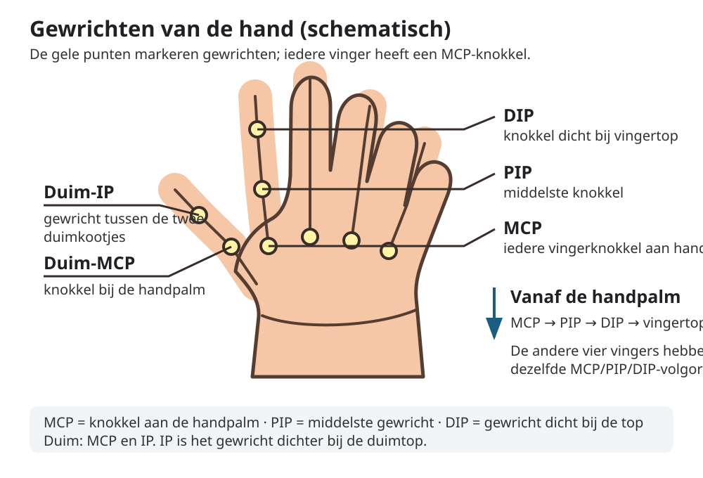

# ASL categorical features and reference matrix

The categorical feature schema is label-independent: it converts one set of
MediaPipe world landmarks into 23 named categories without receiving the letter
label, a reference-matrix value, or a human annotation. The current schema is
`asl-categorical-v4`. Its feature definitions, landmark indices, category
labels, limitations, and initial thresholds are defined in
`gesturelab/features/asl_schema.py`; the extractor is in
`gesturelab/features/categorical_hand.py`.

The 23 features are:

- Thirteen separate MCP/IP/PIP/DIP joint-flexion categories: MCP/PIP/DIP for
  each of the four fingers, plus thumb IP. The finger MCP flexion estimates use
  the wrist-to-MCP direction as a geometric proxy for the metacarpal; they are
  not direct anatomical measurements.
- One thumb MCP position category: `toward_palm`, `neutral`, or
  `away_from_palm`. It uses the signed 3D bend relative to the local palm plane;
  the initial neutral band is 20 degrees. A known MediaPipe handedness
  (`Left`/`Right`) is required to interpret the direction; otherwise the
  extractor returns `unknown`.
- Four binary adjacent-fingertip spread categories (`gespreid` /
  `niet gespreid`), normalized by palm scale.
- One index/middle-finger crossing cue. It is not proof of visibility or
  occlusion.
- Four thumb-to-fingertip proximity categories. Proximity does not prove
  contact.

The initial spread threshold is a fingertip-distance-to-palm-scale ratio of
`0.375`: values at or above it are `gespreid`, lower values are `niet gespreid`.
This is a starting point for later blind calibration, not a validated optimum.
The categorical matrix intentionally contains no hand- or finger-direction
features. The separate Shin feature route remains a distinct model input.

World-landmark distances are estimated geometry, not direct measurements.
`unknown` is an extractor output for indeterminate geometry; it is not an
allowed reference value. Static images cannot represent the movement in J and
Z.

## Review references

### ASL handalfabet


Bron en beeld: [ASL University / Lifeprint — Fingerspelling charts](https://www.lifeprint.com/asl101/topics/sign-language.htm),
copyright © William Vicars. Lifeprint staat hergebruik van de sign-afbeeldingen
op websites toe met bronvermelding en een link naar Lifeprint; zie de
bronpagina voor de voorwaarden. De afbeelding is een onderwijsreferentie, geen
door een centrale ASL-commissie vastgestelde standaard.

Let op twee belangrijke punten bij het nalopen:

- **B:** de duim ligt over de handpalm. De precieze buiging kan verschillen:
  Lifeprint beschrijft zowel een traditionele pose met de duim over de palm
  als een gedeeltelijk gebogen duim in vlot vingerspellen.
- **G:** richtingsvarianten komen voor. In deze projectmatrix bedoelen we
  “links” vanuit de signer bekeken. Bij een rechterhand met de palm naar de
  kijker kan dat op het scherm juist naar rechts lijken. Volg een gekozen
  bronvariant consequent en beschouw andere varianten niet automatisch als fout.

ASL kent regionale en persoonlijke variatie; er is niet één organisatie die
alle handvormen en varianten als enige officiële vorm vastlegt. Het
[NIDCD-overzicht van ASL](https://www.nidcd.nih.gov/health/american-sign-language)
beschrijft ASL als natuurlijke taal en benoemt die variatie. Raadpleeg voor
leren en beoordeling bij voorkeur ook een bevoegde ASL-docent of Deaf signer.

Start the local editor from the project root:

```bash
conda activate ktai-hand-gesture
python -m streamlit run apps/asl_feature_matrix_app.py
```

By default, the app reads and writes
`config/asl_letter_references.json`. This repository includes an unverified
concept draft with a provisional suggestion for every one of the 23 features
for every letter A–Z, based on the local chart `assets/asl_alphabet.jpg`.
These 598 values are visual hypotheses, not measured facts or validated ASL
rules. Some cells list multiple plausible alternatives where a static chart
does not make the feature clear. Every pattern remains `concept`, and none may
be used as a verified rule until a reviewer checks it against a reliable ASL
source. The thumb MCP values for B, L, A, C, I, and J follow the user's stated
examples; other letters are provisional translations of the previous
flexion-only suggestions and need review. The editor's diagnostics can still
report conceptual patterns as unverified; that is intentional even when no
feature cell is blank.
Starting with a different, missing file opens an all-unreviewed matrix. Use
`--matrix PATH` to work with another matrix:

```bash
python -m streamlit run apps/asl_feature_matrix_app.py -- --matrix config/asl_letter_references.json
```

### Reading a cell

- `?` means **not assessed / not established yet**. It is not a prediction,
  does not mean “straight”, and does not mean the feature is irrelevant. The
  included A–Z draft has no such cells, but new or edited matrices may.
- `n.v.t.` means a reviewer explicitly judged that feature not relevant to
  describing this pose. Use it sparingly; it is different from not knowing.
- A named category such as `gestrekt` or `gebogen` is an expected value entered
  for that feature. In this draft it is only a visual hypothesis until you
  review it.
- The **Suggestie / toegestane waarde(n)** multiselect is a dropdown containing
  all valid categories for the selected feature. You may select more than one
  when the source image is ambiguous or a handshape has an allowed variant;
  those choices mean alternative acceptable values, not simultaneous states.
  For example, the F reference allows both spread and non-spread between ring
  finger and pinky. `unknown` is intentionally omitted because it is an
  automatic extractor result, not a human reference category.

For thumb-to-fingertip references, `contact` means the tips visibly touch;
`near` means they are close but do not touch. A distance measured from
MediaPipe landmarks is only an approximation and cannot prove physical contact.

Flexion is recorded **per joint**, not as one overall state for a finger. The
thumb has MCP and IP entries; the other fingers have MCP, PIP, and DIP entries.
The MCP category is approximate because the wrist-to-MCP line stands in for
the metacarpal direction. For example, a finger can be straight at PIP but
hooked at DIP. The draft for X
therefore marks the index PIP as provisionally `gestrekt` and its DIP as
provisionally `gebogen`, while the other fingers are provisionally bent at
both joints. The A draft tentatively marks both thumb joints as `gestrekt`;
change either one independently if the reference shows a bend. A visible
straight-looking finger is a reason to enter `gestrekt` only for the joint
that appears straight—not automatically for every joint of that finger.



- **MCP**: knokkel waar een vinger op de handpalm aansluit.
- **PIP**: middelste gewricht van wijs-, middel-, ringvinger en pink.
- **DIP**: gewricht van die vingers dat het dichtst bij de vingertop zit.
- **IP**: het scharniergewricht van de duim; de duim heeft geen PIP en DIP.

Lees bij de vier vingers vanaf de handpalm: **MCP → PIP → DIP → vingertop**.
In de matrix zijn bij gewone vingers MCP, PIP en DIP als aparte
flexiekenmerken opgenomen; bij de duim MCP en IP.

For each letter, check the draft and correct or clear any unsupported values.
Add only a sourced and reviewed ASL example. Image paths may be absolute or
relative to the matrix file. The editor records the source and reviewer, but
does not independently verify image provenance. Add one or more pose patterns
when a letter has genuine allowed variants; use a feature cell to mark an
expected category, multiple allowed categories, or “not relevant”. Leave
unsupported values unreviewed. A pattern marked “verified” requires a source,
reviewer, and explanatory note.

The Overview tab shows the matrix. The Diagnostics tab highlights unreviewed
cells, concept-only patterns, pairs without disjoint references for every
allowed pattern combination, and identical fully specified patterns. These
are checks on the entered references, not claims about linguistic correctness
or actual model accuracy.

Download JSON for a versioned schema-and-reference bundle, CSV for a flat
matrix, or HTML for a readable snapshot. The app does not extract landmarks,
start calibration, train a model, or write a reference file until a save action
is submitted.

## Blind image-feature annotation

The separate annotation app records what a human reviewer can see in one image.
It hides the letter label, matrix, and model output. Only included images with
successful hand detection in the dataset's existing `development` role can be
annotated; reserved `test` images cannot be saved.

```bash
python -m streamlit run apps/asl_feature_annotation_app.py -- --project data/asl_kaggle
```

Use a stable, non-identifying annotator ID. Each annotator's values are stored
independently in `PROJECT/annotations/asl_feature_annotations.json`; a second
reviewer does not overwrite the first. The file records sample ID and source
image hash, and is rejected if the source changes or a sample becomes excluded,
unanalyzed, or test data. Leaving a feature unreviewed is different from marking
it “not assessable”. Automatic `unknown` is never accepted as a human label.
The app reports exact agreement only on image-feature pairs with at least two
assessments; it does not calculate chance-corrected agreement or claim that
reviewers share the same interpretation.

## Second-dataset CSV adapter

The adapter intentionally does not assume the format or identity of an
unspecified second dataset. Prepare a CSV whose image paths are relative to a
local image root:

```csv
image_path,label,participant,session,condition,role,source_group
train/A/example-001.jpg,A,p01,session-01,baseline,development,source-block-01
test/A/example-002.jpg,A,p99,session-test,baseline,test,source-block-test
```

`label` must be one A–Z letter; `role` must be `development` or `test`; all
other fields are required. Assign the same `source_group` to correlated,
augmented, or duplicate images so grouped validation cannot separate them.
Keep each group entirely within development or test. The adapter verifies the
CSV, image paths, A–Z labels, and duplicate pixels before writing a new dataset.
It preserves the supplied source name and CSV, and imports images as pending;
it does not run hand detection or train a model.

```bash
python -m scripts.import_asl_csv \
  --csv data/external/second_asl/metadata.csv \
  --images-root data/external/second_asl \
  --source-name "USE THE ACTUAL DATASET NAME" \
  --project data/asl_second
python -m scripts.analyze_dataset --project data/asl_second
```

Replace the example paths and source name with the actual dataset details. Use
a new project directory; imported source data remains separate from existing
datasets. After landmark analysis, use the normal split preparation workflow
only after assigning and checking source groups and a reserved test set.

## Assign calibration roles and calibrate thresholds

After importing and analyzing images, freeze a group-aware calibration split.
The first grouped fold is held out for validation; the other development
images are calibration-train. Existing reserved test images are recorded as
`final_test` and are never annotated or scored by the calibrator.

```bash
python -m scripts.prepare_asl_roles \
  --project data/asl_second \
  --out exports/asl_feature_roles.json \
  --grouping source --folds 5 --seed 42
python -m streamlit run apps.asl_feature_annotation_app.py -- --project data/asl_second
```

Annotate images independently with at least two reviewers when possible.
The repo includes `config/asl_feature_candidates.example.json` as a format
example. These candidate values are illustrative only, not recommendations.
Create a reviewed UTF-8 JSON file containing the candidates appropriate for
your annotations. Each candidate may override any subset of the versioned
threshold groups; omitted values retain their schema defaults:

```json
{
  "candidates": [
    {},
    {"flexion": {"extended_min_deg": 155, "bent_max_deg": 120}},
    {"spread": {"minimum_spread_ratio": 0.50}}
  ]
}
```

Include the current default candidate as `{}`. Then run the calibration
explicitly; replace the example candidate path with your reviewed file:

```bash
python -m scripts.calibrate_asl_features \
  --project data/asl_second \
  --role-map exports/asl_feature_roles.json \
  --candidates config/asl_feature_candidates.example.json \
  --out experiments/asl_feature_calibration_01
```

The calibrator uses unanimous human categories from calibration-train images
to choose the candidate with the highest mean per-feature macro-F1 (coverage
and then input order break ties). It reports the chosen candidate and baseline
on the untouched calibration-validation images, saves the threshold JSON and
source hashes, and never fits a letter classifier. Disagreements and
not-assessable features are excluded. This does not evaluate ASL letter
recognition or touch `final_test`. Use a new output directory for each run.

## Fixed categorical model routes

The registered one-hot model input contains all 23 categorical features,
including an explicit `unknown` value for each. SVM and MLP receive identical
columns, one-hot encoding, development IDs, and grouped train/validation roles.
The MLP uses the repository's fixed `(64, 32)` balanced-weight preset. These
are fixed comparisons, not hyperparameter sweeps. The rules route abstains
unless a unique, sufficiently supported pattern marked `verified` matches;
concept and unreviewed patterns never become rules.

The same model runner accepts `--input categorical` (23 categorical features),
`--input shin2021_combined` (the established 820 image-landmark inputs), or
`--input categorical_plus_shin2021` (both inputs, unchanged Shin values plus
one-hot categories). These use identical frozen groups and classifier settings.
Shin distances retain their per-image z-score; axes remain direction cosines.
No dataset-fitted normalization is added to the Shin routes.

After freezing the feature thresholds and reference matrix, run a fixed route
explicitly. Examples:

```bash
python -m scripts.train_asl_categorical \
  --project data/asl_second \
  --role-map exports/asl_feature_roles.json \
  --model svm \
  --input categorical_plus_shin2021 \
  --thresholds experiments/asl_feature_calibration_01/categorical_thresholds.json \
  --out experiments/asl_categorical_plus_shin_svm_01
python -m scripts.train_asl_categorical \
  --project data/asl_second \
  --role-map exports/asl_feature_roles.json \
  --model mlp \
  --input categorical_plus_shin2021 \
  --thresholds experiments/asl_feature_calibration_01/categorical_thresholds.json \
  --out experiments/asl_categorical_plus_shin_mlp_01
python -m scripts.train_asl_categorical \
  --project data/asl_second \
  --role-map exports/asl_feature_roles.json \
  --model rules \
  --reference-matrix config/asl_letter_references.json \
  --thresholds experiments/asl_feature_calibration_01/categorical_thresholds.json \
  --out experiments/asl_categorical_rules_01
```

Each route reports validation results, records per-letter metrics and the
confusion matrix, then saves a model using all development images. Reserved
test images are listed in the frozen split but are never evaluated. Existing
output directories are not overwritten. SVM/MLP bundles use the local webcam
prediction interface and can be registered using the normal `scripts.research
register` command. The rules route is deterministic and does not fit classifier
weights.

## Feature importance and ablations

Permutation importance permutes all one-hot columns for each categorical
feature, or all distance/axis columns as two groups for Shin inputs, together
on the saved validation rows. This preserves valid one-hot inputs and reports
macro-F1 drop across fixed repeats; it is predictive association, not
causality. Ablations refit one fixed SVM/MLP on the frozen training rows with
each named feature group removed, then compare the same validation split.
These commands perform computations only when explicitly run:

```bash
python -m scripts.analyze_asl_feature_importance \
  --run experiments/asl_categorical_plus_shin_svm_01 \
  --out exports/asl_importance_01 --repeats 20 --seed 42
python -m scripts.ablate_asl_features \
  --run experiments/asl_categorical_plus_shin_svm_01 \
  --out experiments/asl_ablation_01 --seed 42
```

The ablation command fits models on development training rows only; it does not
use or evaluate reserved test images. Repeated comparisons on a fixed
validation set are exploratory and do not establish independent performance.

An independent final letter-recognition report remains a separate task; do
not infer final performance from calibration, validation, or feature analysis.

## Scope and next steps

The matrix, extractor, and human annotation app are foundations, not a completed
training workflow. Dataset import, role assignment, annotation, calibration,
categorical rule/SVM/MLP routes, Shin combinations, permutation importance,
and feature-ablation commands are available but have only been exercised on
synthetic tests in this implementation. Independent final letter-recognition
evaluation is not implemented. Do not treat initial thresholds or concept
patterns as calibrated ASL rules. No real-data calibration, model training,
feature ablations, or full evaluation have been run for this work.
