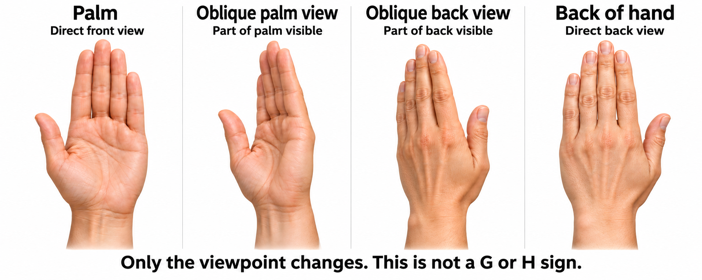

# Capture G and H from four viewpoints

We test whether the same intended letter is recognized differently when the palm or the back of the hand faces the camera. The same saved images are subsequently compared across the existing models. This is a first paired viewpoint experiment: the views are qualitative categories, not measured rotation angles.



The image is an AI-generated orientation guide showing an open hand. It does not demonstrate a G or H sign and is not an authoritative ASL instruction.

## Required images

Three participants (P01, P02, P03) each capture 40 photos:

| Viewpoint | G | H |
|---|---:|---:|
| Palm directly facing the camera | 5 | 5 |
| Oblique palm view; part of the palm remains visible | 5 | 5 |
| Oblique back view; part of the back remains visible | 5 | 5 |
| Back of the hand directly facing the camera | 5 | 5 |
| Total per participant | 20 | 20 |

Total: 120 photos, or 80 with two participants. The additional oblique back view replaces the earlier three-view plan of 60/90 photos.

Form the same intended G or H with the same hand throughout. For G the index finger is extended and the middle, ring and little fingers are bent; for H both the index and middle fingers are extended. Keep the thumb position consistent within each letter. The open hand in the guide only illustrates orientation. Relax and form the sign again for every attempt, rather than saving five nearly identical video frames.

Use the same camera, lighting, background and approximate distance. Include the whole hand and wrist, preferably without the face. Keep the position and direction of extended fingers as consistent as possible when changing the visible side. Some variation remains: this is not a calibrated 3D rotation experiment. Obtain participants' consent before storing photos locally.

The default is the right hand for everyone. Another choice can be recorded at startup, but each participant must use the same selected hand throughout. Handedness is a possible additional factor to report in the analysis.

## Start

Close other camera apps and windows. From the repository root:

```bash
conda activate ktai-hand-gesture
python -m research.gh_view_capture
```

The camera starts only when this command runs. The terminal prints the session directory. Every start without `--resume` creates a new session.

For two participants:

```bash
python -m research.gh_view_capture --participants 2
```

If P01 and P03 use the right hand and P02 uses the left:

```bash
python -m research.gh_view_capture --hands right left right
```

## Controls

1. Check the participant code and requested hand. Press Enter to start that participant.
2. Read the requested letter, viewpoint and repetition. The fixed sequence alternates conditions to limit order effects.
3. Form the sign and press Space or click the capture button.
4. The selected frame freezes. Press Enter to save the attempt. The intended letter is prefilled and locked.
5. Relax and follow the next task. After 40 photos, the tool explicitly asks for the next participant.

Save every planned attempt, including failed detections. Predictions are hidden to prevent outcome-driven adjustment. Use Esc on the confirmation screen only for a procedural mistake, such as the wrong participant or sign, or an accidental keypress; do not replace a classifier error. Q/Esc in the live window pauses the session and releases the camera.

## Pause and resume

Use the actual session directory printed at startup:

```bash
python -m research.gh_view_capture --resume captures/gh_viewpoint/GH_views_DATE_ID
```

The tool counts finalized captures and continues with the first missing task. Confirm the current participant again after resuming. To inspect progress without opening the camera:

```bash
python -m research.gh_view_capture --resume captures/gh_viewpoint/GH_views_DATE_ID --status
```

## Saved information and evaluation

Each photo has its own directory containing the unchanged camera frame, exact detector input, a preview without the predicted letter, and `capture.json`. Metadata include participant code, requested hand, intended letter, viewpoint, repetition, detection status, landmarks, features, model hash and hidden prediction. `session.json` stores the fixed plan and comparison-model hashes. Captures remain local under `captures/gh_viewpoint/` and are not training data.

P01 is development. Reserve P02 and P03 for checking a predefined approach. Two additional participants still do not justify population-wide claims. With frozen models, compare viewpoints within each participant. Report detection coverage, accuracy, macro-F1 and G/H confusion by participant and viewpoint, acknowledging the small sample. Do not adapt a model using results intended as a final check.

Legacy Dutch viewpoint IDs remain in saved metadata for compatibility; the interface displays English labels.
