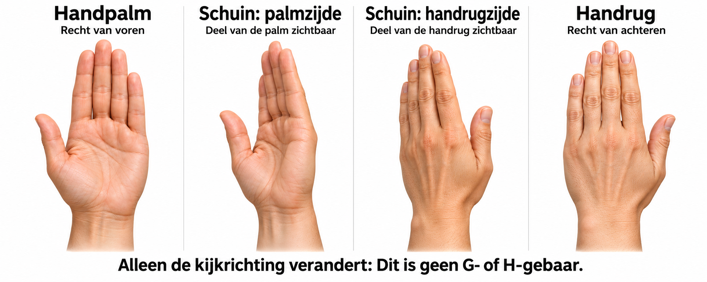

# G en H opnemen vanuit vier kijkrichtingen

We willen meten of dezelfde bedoelde letter anders wordt herkend wanneer de camera de palmzijde of handrugzijde ziet. We vergelijken daarna dezelfde beelden met de bestaande modellen. Dit is een eerste gepaarde kijkrichtingsproef; de standen zijn visuele categorieën, geen gemeten rotatiehoeken.



Het plaatje is een AI-gegenereerde richtingshulp met een open hand. Het toont geen G- of H-gebaar en is geen bron voor de officiële uitvoering van ASL.

## Welke beelden?

Drie personen (P01, P02, P03) maken ieder 40 foto's:

| Kijkrichting | G | H |
|---|---:|---:|
| Handpalm recht naar de camera | 5 | 5 |
| Schuin vanuit de palmstand; deel van palm zichtbaar | 5 | 5 |
| Schuin vanuit de handrugstand; deel van handrug zichtbaar | 5 | 5 |
| Handrug recht naar de camera | 5 | 5 |
| Totaal per persoon | 20 | 20 |

Totaal: 120 foto's. Met twee personen zijn het 80 foto's. De extra schuine handrugstand vervangt het eerdere plan met drie kijkrichtingen en 60/90 foto's.

Vorm steeds dezelfde bedoelde G of H, met dezelfde hand. Bij G is de wijsvinger gestrekt en zijn middelvinger, ringvinger en pink gebogen. Bij H zijn wijs- en middelvinger gestrekt. Houd de duimstand zo consistent mogelijk binnen dezelfde letter; de open hand op het plaatje is alleen een richtingshulp. Ontspan en vorm het gebaar opnieuw voor elke poging: geen serie van vijf bijna identieke videoframes.

Houd dezelfde camera, verlichting, achtergrond en ongeveer dezelfde afstand. Breng de volledige hand en pols in beeld, bij voorkeur zonder gezicht. Probeer positie en richting van de gestrekte vingers zo veel mogelijk gelijk te houden wanneer je de zichtbare zijde verandert. Kleine veranderingen blijven mogelijk; deze proef is geen volledig gekalibreerd 3D-rotatie-experiment. Vraag deelnemers vooraf toestemming voor de lokale foto-opnamen.

Standaard gebruikt iedereen de rechterhand. Een andere keuze kan bij het starten worden vastgelegd, maar gebruik per persoon steeds dezelfde gekozen hand. Links/rechts is een mogelijke extra factor en moet bij de analyse worden vermeld.

## Starten

Sluit andere camera-apps en cameravensters. Vanuit de repository:

```bash
conda activate ktai-hand-gesture
python -m research.gh_view_capture
```

De camera start pas als je dit commando uitvoert. De tool toont de sessiemap in de terminal. Iedere start zonder `--resume` maakt een nieuwe sessie.

Voor twee personen:

```bash
python -m research.gh_view_capture --participants 2
```

Als P01 en P03 rechts gebruiken en P02 links:

```bash
python -m research.gh_view_capture --hands right left right
```

## Bediening

1. Controleer bij de start of persoonscode en gevraagde hand kloppen. Druk Enter om die persoon te starten.
2. Lees de opdracht: letter, kijkrichting en herhaling. De volgorde is vooraf vastgelegd en wisselt om volgorde-effecten te beperken.
3. Vorm het gebaar en druk Spatie of klik op de fotoknop.
4. De gekozen foto staat stil. Druk Enter om de poging te bewaren. De bedoelde letter is vooraf ingevuld en staat vast.
5. Ontspan je hand en volg de volgende opdracht. Na 40 foto's vraagt de tool expliciet om de volgende persoon.

Bewaar alle geplande pogingen, ook als de detectie mislukt. De voorspelling is tijdens verzamelen verborgen, zodat je niet op basis van de uitkomst bijstuurt. Gebruik Esc in het bevestigingsscherm alleen voor een verkeerde uitvoering, bijvoorbeeld de verkeerde persoon/letter of een onbedoelde druk op de knop; niet om een modelmisser te vervangen. Q/Esc in het livevenster pauzeert de sessie en geeft de camera vrij.

## Pauzeren en hervatten

Gebruik de echte sessiemap die de terminal bij de start toont:

```bash
python -m research.gh_view_capture --resume captures/gh_viewpoint/GH_views_DATUM_ID
```

De tool telt definitief opgeslagen opnamen en gaat naar de eerstvolgende ontbrekende taak. Na hervatten bevestig je de huidige persoon opnieuw. Voortgang bekijken zonder de camera te openen:

```bash
python -m research.gh_view_capture --resume captures/gh_viewpoint/GH_views_DATUM_ID --status
```

## Wat wordt bewaard?

Iedere foto heeft een eigen map met ongewijzigd camerabeeld, de exacte detectorinvoer, een voorvertoning zonder voorspelde letter en `capture.json`. De metadata bevatten persoonscode, gewenste hand, bedoelde letter, kijkrichting, herhaling, detectiestatus, landmarks, features, modelhash en de verborgen voorspelling. `session.json` bewaart het vaste plan en hashes van de bestaande vergelijkingsmodellen. De opnamen staan lokaal onder `captures/gh_viewpoint/` en zijn geen trainingsdata.

P01 is ontwikkeling. Houd de resultaten van P02 en P03 apart voor controle van een vooraf vastgelegde aanpak. Ook met deze twee extra personen kunnen we nog geen brede bevolkingsclaims doen. Als we alleen de vooraf vastgelegde modellen vergelijken, kunnen dezelfde kijkrichtingen binnen iedere persoon worden vergeleken. Na afloop analyseren we detectiedekking, accuracy, macro-F1 en G/H-verwarring per persoon en kijkrichting, met de kleine aantallen expliciet vermeld. Pas geen model aan op de uitkomsten die je als eindcontrole wilt gebruiken.
