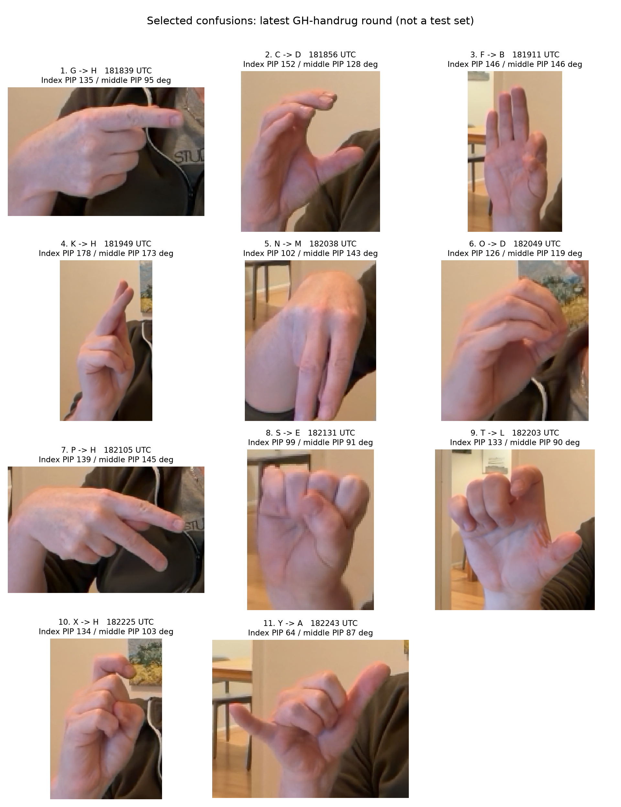

# Analyse van ronde GH-handrug — 31 oktober 2026

Gevonden: 11 bevestigde verwarringsopnamen, van 19:18:39 tot 19:22:43 (Europe/Amsterdam). Alle opnamen horen bij ronde `20261031T181714Z_df8bf30f`, naam **GH-handrug**, ronde 1, en exact hetzelfde G/H-model (SHA256 `1f5a52da8601d3650e388243e70550d26f65883db9c22a2fb5f31e554d0bfc57`). Alle beeldchecksums zijn gecontroleerd en alle opgeslagen G/H-voorspellingen zijn exact gereproduceerd. Geen model is aangepast of getraind tijdens deze analyse. Er zit geen nieuw als H gelabeld beeld in deze ronde.

## Welke verwarringen?

| Bedoeld | G/H-draaitraining | Vingerhoeken | Kanteltraining alle |
|---|---|---|---|
| G | H | A | A |
| C | D | D | D |
| F | B | B | B |
| K | H | K | K |
| N | M | M | M |
| O | D | D | O |
| P | H | M | M |
| S | E | E | E |
| T | L | L | L |
| X | H | X | X |
| Y | A | A | A |

Dit zijn bewust geselecteerde fouten: 0/11 correcte G/H-voorspellingen is daarom geen schatting van de live-accuracy. De modelvergelijking gebruikt exact dezelfde opgeslagen landmarks, zonder opnieuw te detecteren.

## Belangrijkste bevindingen

**G: de middelvinger wordt wel als gebogen gemeten.** De 3D-PIP-hoek van de middelvinger is 95,3°. De trainingsmediaan is 86,7° voor G en 166,2° voor H. Dit specifieke signaal past dus beter bij G. De wijsvinger krijgt echter een 3D-PIP-hoek van 134,9°, tegenover een G-trainingsmediaan van 172,6°. In de 2D-pixelprojectie is dezelfde wijsvingerhoek 174,5°. Dat verklaart waarom de zichtbare landmarks veel gestrekter ogen dan de toegevoegde 3D-hoekfeature. Het bewijst niet dat de 3D-hoek onjuist is: perspectief en projectie veranderen hoeken. Wel is het een concrete aanwijzing om de bruikbaarheid van beide representaties samen te onderzoeken. G staat tweede in de G/H-modelrangschikking. Beslissingsscores zijn geen kansen.

**K en X: concrete regressies door de G/H-augmentatie.** Het gewone Vingerhoeken-model herkent deze twee beelden correct. Het G/H-model noemt beide H. De grote draaiingen hebben de beslissingsgrenzen hier dus ongunstig veranderd. Bij K zijn wijs en middel werkelijk als gestrekt gemeten (178,5° en 172,8°), zodat hun buiging alleen K en H niet voldoende onderscheidt. Duimpositie en oriëntatie blijven relevant.

**F: contactinformatie is zichtbaar maar leidt nog niet tot F.** De duim en wijsvinger sluiten in de foto aan. De berekende afstand tussen de toppen is 0,13 maal de polslengte naar het middelvinger-MCP (een palmmaat). Toch voorspellen alle vijf modellen B. De index-PIP is in de pixelprojectie 2,8°, tegenover 146,3° in de 3D-schatting. Bij teruggevouwen/overlappende vingers zijn projectiehoeken geen fysieke gewrichtshoeken; dit is een representatieverschil, geen bewijs van een codefout.

**C en O: geen nieuwe oplossing met G/H-draaiingen.** C blijft D; O blijft D. Het eerdere all-letter-kantelmodel herkent deze O wel als O. De vijf dichtstbijzijnde oorspronkelijke trainingsvoorbeelden in de volledige Vingerhoeken-invoerruimte zijn voor C allemaal C; de vijf dichtstbijzijnde op alleen gestandaardiseerde gewrichtshoeken zijn voor O allemaal O. Dat is een diagnostische afstandsvergelijking en geen bewijs dat een nearest-neighbor-classifier beter generaliseert.

**N/M, S/E en T/L:** deze verwarringen bestaan ook zonder G/H-augmentatie. Gebogen vingers hebben onderling vergelijkbare hoeken; duimpositie en contact zijn mogelijke extra onderscheidende signalen. In dit T-beeld zijn de vijf dichtstbijzijnde volledige trainingsvoorbeelden allemaal T, terwijl de SVM L kiest.

**P/H en Y/A:** bij P worden index en middel in de 3D-schatting minder gestrekt gemeten (139° en 145°) dan ze in de pixelprojectie lijken (179° en 176°). De volledige trainingsburen zijn N; de hoekburen H. Bij Y zijn alle vijf dichtstbijzijnde trainingsburen Y, zowel op de hoeken als op de volledige invoer, maar de modellen kiezen M of A. Alleen meer G/H-draaiingen toevoegen lijkt daarom geen algemene oplossing.

## Voorgestelde vervolgstappen

1. **Gebruik Vingerhoeken voorlopig als referentie en houd G/H-draaitraining experimenteel.** De nieuwe K/X-fouten en de eerdere iets lagere vijfvoudige scores geven geen reden om het G/H-model algemeen te verkiezen.

2. **Test 2D-buigingsmetingen naast de bestaande 3D-hoeken.** Bereken deze in echte pixelverhoudingen en voeg bijvoorbeeld PIP/DIP-hoeken en verhouding top-tot-knokkel/vingerlengte toe. Dit kan de zichtbare rechte wijsvinger van G en de gevouwen wijsvinger van F explicieter weergeven. 2D-metingen zijn zelf afhankelijk van kijkrichting: ze moeten aanvullende signalen zijn, geen veronderstelde anatomische waarheid. Train en vergelijk op dezelfde oorspronkelijke vijf folds; bereken alle normalisatie uitsluitend op de trainingspartitie.

3. **Onderzoek een kleine, getrainde G/H-onderscheider op handvorm.** De middelvingerbuiging is hier bruikbaar. Een tweede stap voor alleen G/H-twijfelgevallen kan dat signaal gericht gebruiken. Een harde regel op deze ene opname of een algemene H-naar-G-correctie zou K/X/P kunnen beschadigen. Controleer daarom de activatie van zo’n tweede stap en de prestaties van alle 26 letters.

4. **Test expliciete contact/duimfeatures afzonderlijk.** Voor F/B gaat het om duim-wijscontact; voor N/M/S/T onder meer om de duim ten opzichte van de gebogen vingers. Er zitten al onderlinge afstanden in Shin; dit is vooral een gerichtere representatie, geen garantie op nieuwe informatie. De eerdere volledige categorische uitbreiding gaf geen consistent voordeel, dus vergelijk dit als kleine, gerichte ablaties.

5. **Verzamel een vaste G/H-ronde met goede én foute pogingen.** Beide letters, palm/handrug/tussenstand, meerdere pogingen en bij voorkeur een tweede persoon. Gebruik de huidige geselecteerde fouten voor ontwikkeling; bewaar een nieuwe ronde voor controle nadat de aanpak vastligt. Als de 3D-landmarks bij bepaalde kijkrichtingen structureel afwijken, kunnen echte aanvullende trainingsbeelden helpen waar synthetische feature-rotaties de detector niet nabootsen.

**Eerste aanbevolen experiment:** Vingerhoeken plus aanvullende 2D-vingerbuigingen, zonder de grote G/H-rotaties. Vervolgens een afzonderlijke contact-ablatietest. Daarmee onderzoeken we eerst het meetverschil dat in deze beelden daadwerkelijk zichtbaar is.

## Controleerbaarheid

`analysis.json` bevat modelhashes, opname-IDs, trainingspercentielen, 2D/3D-hoeken en trainingsburen. `model_comparison.csv` bevat de herberekende voorspellingen van alle vijf modellen. `hand_crops.png` toont alleen handuitsneden van de elf opnamen. De numerieke analyse is opnieuw uit te voeren met `MPLCONFIGDIR=/tmp/ktai-mpl python -m research.studies.review_GH_captures`. Dit verslag bevat AI-gegenereerde interpretaties; hypotheses over oorzaken zijn niet onafhankelijk gevalideerd.
