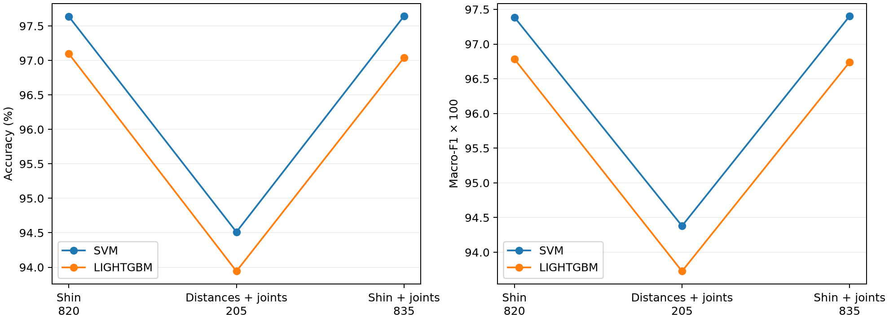
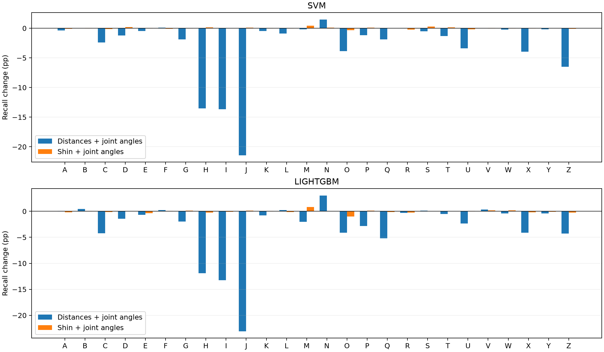

# Shin directions versus explicit joint angles

The primary comparison uses identical normalized image x/y/z landmarks for every feature. No landmark redetection, image selection, augmentation or model tuning was performed. The 60,251 accepted images and five frozen filename-block folds are shared across arms. The 15 joint measurements are 14 interior angles plus signed thumb MCP deviation, using the historical definitions. Finger MCP values are wrist-based proxies, not clinical joint angles. Coordinates are not aspect corrected, to match Shin exactly.

| Classifier | Representation | Inputs | Accuracy | Macro-F1 | Fixed / lost versus Shin |
|---|---|---:|---:|---:|---:|
| svm | Shin reference | 820 | 97.63655% | 0.973862 | 0 / 0 |
| svm | Distances + joint angles | 205 | 94.51129% | 0.943797 | 284 / 2167 |
| svm | Shin + joint angles | 835 | 97.64319% | 0.974028 | 89 / 85 |
| svm | Shin + world angles (earlier) | 835 | 97.74776% | 0.975244 | 143 / 76 |
| lightgbm | Shin reference | 820 | 97.09714% | 0.967843 | 0 / 0 |
| lightgbm | Distances + joint angles | 205 | 93.94201% | 0.937267 | 515 / 2416 |
| lightgbm | Shin + joint angles | 835 | 97.04071% | 0.967403 | 138 / 172 |
| lightgbm | Shin + world angles (earlier) | 835 | 97.01748% | 0.966920 | 98 / 146 |

## Findings

- SVM: replacing directions changes accuracy by -3.125 percentage points. Adding same-coordinate joints changes accuracy by +0.0066 points (+4 net correct images).
- LIGHTGBM: replacing directions changes accuracy by -3.155 percentage points. Adding same-coordinate joints changes accuracy by -0.0564 points (-34 net correct images).

Under these fixed model recipes, joint measurements do not replace axis-relative direction information successfully. Adding the derived same-coordinate measurements yields no convincing overall gain. For SVM, the earlier world-coordinate addition gains 67 correct images, versus 4 for the same-coordinate addition. The larger earlier gain therefore cannot be attributed to the bending-angle formula alone; the coordinate representation also matters. This does not establish anatomical accuracy or generalization to unseen people.




## Per-letter effects



The full `per_letter.csv` contains precision, recall and F1 for all 26 letters. Confusion matrices use true letters as rows and predictions as columns. `metrics.csv` includes all fold scores; `paired_changes.csv` counts corrected and newly incorrect images on paired predictions.

### SVM: recall for every letter

| Letter | Images | Shin | Distances + joints | Shin + joints | Replacement change (pp) | Addition change (pp) |
|---|---:|---:|---:|---:|---:|---:|
| A | 2188 | 98.67% | 98.31% | 98.58% | -0.37 | -0.09 |
| B | 2204 | 99.77% | 99.77% | 99.82% | +0.00 | +0.05 |
| C | 1912 | 99.84% | 97.44% | 99.69% | -2.41 | -0.16 |
| D | 2456 | 97.68% | 96.46% | 97.88% | -1.22 | +0.20 |
| E | 2308 | 99.00% | 98.53% | 99.05% | -0.48 | +0.04 |
| F | 2859 | 98.60% | 98.71% | 98.53% | +0.10 | -0.07 |
| G | 2430 | 99.42% | 97.53% | 99.38% | -1.89 | -0.04 |
| H | 2371 | 98.14% | 84.61% | 98.31% | -13.54 | +0.17 |
| I | 2380 | 96.68% | 83.03% | 96.68% | -13.66 | +0.00 |
| J | 2576 | 96.78% | 75.35% | 96.86% | -21.43 | +0.08 |
| K | 2701 | 98.26% | 97.78% | 98.30% | -0.48 | +0.04 |
| L | 2516 | 99.64% | 98.73% | 99.60% | -0.91 | -0.04 |
| M | 1602 | 90.01% | 89.83% | 90.45% | -0.19 | +0.44 |
| N | 1280 | 88.12% | 89.61% | 88.20% | +1.48 | +0.08 |
| O | 2264 | 98.19% | 94.35% | 97.88% | -3.84 | -0.31 |
| P | 2041 | 98.63% | 97.45% | 98.73% | -1.18 | +0.10 |
| Q | 2106 | 97.72% | 95.82% | 97.72% | -1.90 | +0.00 |
| R | 2543 | 93.43% | 93.47% | 93.20% | +0.04 | -0.24 |
| S | 2559 | 98.09% | 97.58% | 98.36% | -0.51 | +0.27 |
| T | 2354 | 98.43% | 97.11% | 98.56% | -1.32 | +0.13 |
| U | 2513 | 96.70% | 93.31% | 96.50% | -3.38 | -0.20 |
| V | 2552 | 98.24% | 98.24% | 98.28% | +0.00 | +0.04 |
| W | 2456 | 98.25% | 98.00% | 98.21% | -0.24 | -0.04 |
| X | 2157 | 97.03% | 93.09% | 96.99% | -3.94 | -0.05 |
| Y | 2580 | 99.46% | 99.26% | 99.46% | -0.19 | +0.00 |
| Z | 2343 | 97.44% | 90.95% | 97.35% | -6.49 | -0.09 |

### SVM: paired fold differences

| Variant | Mean accuracy change (pp) | SD of fold changes (pp) | Improved / tied / worse folds |
|---|---:|---:|---|
| Distances + joint angles | -3.132 | 1.410 | 0 / 0 / 5 |
| Shin + joint angles | +0.004 | 0.043 | 3 / 0 / 2 |

Fold dispersion is descriptive, not an independent confidence interval. Mean fold changes weight folds equally; pooled scores weight images equally.

### SVM: largest replacement confusions

| True → predicted | Shin | Distances + joints | Shin + joints |
|---|---:|---:|---:|
| J → I | 28 | 531 | 31 |
| I → J | 5 | 332 | 4 |
| H → U | 0 | 230 | 0 |
| N → M | 140 | 119 | 139 |
| R → U | 149 | 114 | 156 |
| X → Z | 13 | 100 | 17 |
| M → N | 127 | 81 | 121 |
| U → H | 0 | 80 | 0 |
| O → D | 12 | 73 | 17 |
| Z → X | 30 | 71 | 32 |

J and Z are static dataset images in this experiment; these counts do not evaluate motion recognition.

### LIGHTGBM: recall for every letter

| Letter | Images | Shin | Distances + joints | Shin + joints | Replacement change (pp) | Addition change (pp) |
|---|---:|---:|---:|---:|---:|---:|
| A | 2188 | 98.03% | 98.08% | 97.85% | +0.05 | -0.18 |
| B | 2204 | 99.18% | 99.64% | 99.14% | +0.45 | -0.05 |
| C | 1912 | 98.74% | 94.51% | 98.59% | -4.24 | -0.16 |
| D | 2456 | 97.19% | 95.77% | 97.19% | -1.43 | +0.00 |
| E | 2308 | 98.53% | 97.83% | 98.18% | -0.69 | -0.35 |
| F | 2859 | 98.36% | 98.57% | 98.43% | +0.21 | +0.07 |
| G | 2430 | 98.89% | 96.91% | 99.01% | -1.98 | +0.12 |
| H | 2371 | 97.34% | 85.45% | 97.09% | -11.89 | -0.25 |
| I | 2380 | 96.34% | 83.11% | 96.26% | -13.24 | -0.08 |
| J | 2576 | 96.97% | 73.91% | 97.09% | -23.06 | +0.12 |
| K | 2701 | 97.89% | 97.08% | 97.96% | -0.81 | +0.07 |
| L | 2516 | 98.45% | 98.69% | 98.33% | +0.24 | -0.12 |
| M | 1602 | 88.45% | 86.45% | 89.26% | -2.00 | +0.81 |
| N | 1280 | 85.16% | 88.20% | 85.16% | +3.05 | +0.00 |
| O | 2264 | 93.90% | 89.80% | 92.89% | -4.11 | -1.02 |
| P | 2041 | 98.48% | 95.64% | 98.63% | -2.84 | +0.15 |
| Q | 2106 | 98.53% | 93.35% | 98.39% | -5.18 | -0.14 |
| R | 2543 | 95.24% | 94.93% | 94.97% | -0.31 | -0.28 |
| S | 2559 | 97.73% | 97.85% | 97.73% | +0.12 | +0.00 |
| T | 2354 | 98.05% | 97.54% | 98.09% | -0.51 | +0.04 |
| U | 2513 | 96.74% | 94.39% | 96.82% | -2.35 | +0.08 |
| V | 2552 | 97.73% | 98.04% | 97.92% | +0.31 | +0.20 |
| W | 2456 | 98.37% | 97.96% | 98.53% | -0.41 | +0.16 |
| X | 2157 | 96.89% | 92.77% | 96.71% | -4.13 | -0.19 |
| Y | 2580 | 99.42% | 98.99% | 99.34% | -0.43 | -0.08 |
| Z | 2343 | 95.69% | 91.42% | 95.43% | -4.27 | -0.26 |

### LIGHTGBM: paired fold differences

| Variant | Mean accuracy change (pp) | SD of fold changes (pp) | Improved / tied / worse folds |
|---|---:|---:|---|
| Distances + joint angles | -3.159 | 1.571 | 0 / 0 / 5 |
| Shin + joint angles | -0.035 | 0.142 | 3 / 0 / 2 |

Fold dispersion is descriptive, not an independent confidence interval. Mean fold changes weight folds equally; pooled scores weight images equally.

### LIGHTGBM: largest replacement confusions

| True → predicted | Shin | Distances + joints | Shin + joints |
|---|---:|---:|---:|
| J → I | 34 | 559 | 36 |
| I → J | 11 | 338 | 12 |
| H → U | 0 | 201 | 0 |
| N → M | 179 | 138 | 177 |
| M → N | 146 | 108 | 132 |
| X → Z | 7 | 98 | 5 |
| O → D | 101 | 91 | 127 |
| O → P | 0 | 91 | 0 |
| R → U | 100 | 81 | 105 |
| J → E | 15 | 77 | 11 |

J and Z are static dataset images in this experiment; these counts do not evaluate motion recognition.

## Interpretation and limits

Replacing the 630 direction features tests a compact representation, but it also removes absolute axis-relative orientation. Hand orientation can distinguish letters, so a lower replacement score would not mean joint angles are incorrectly calculated. Adding joint angles tests whether making a derived nonlinear relationship explicit helps the fixed classifier. With the same coordinates these measurements largely re-express information already present in the directions; they do not constitute a new sensor.

The earlier world-angle arm uses a different estimated coordinate representation. Its difference from the new same-coordinate arm is informative about that representation, but does not isolate individual landmark estimation errors or establish causality.

SVM uses RBF C=10, gamma=scale, balanced. LightGBM uses 100 trees, 31 leaves, learning rate 0.1, min child samples 20 and seed 42. Median imputation and standardization of added angles are fitted on each training fold only; Shin inputs pass through unchanged. gamma=scale adapts to each input representation, so these are fixed recipe comparisons, not a claim that every feature set has been optimally tuned. Baseline and historical world-arm OOF predictions are reused only after checking hashes, IDs, labels and fold membership.

These repeatedly inspected development folds are not an independent final test, and filename blocks are not verified people. Scores are conditional on accepted hand detections. Synthetic geometric rotation invariance does not guarantee live-camera robustness. No deployed live model was replaced.

## Reproduce

```bash
conda activate ktai-hand-gesture
MPLCONFIGDIR=/tmp/ktai-mpl python -m research.studies.compare_direction_joint
```

Models and prediction checkpoints are under `runs/direction_joint_01/`; numeric results and this report are under `results/direction_joint_01/`. Re-running resumes completed folds after validating input provenance. Use new `--out` and `--work` directories for a different configuration.
