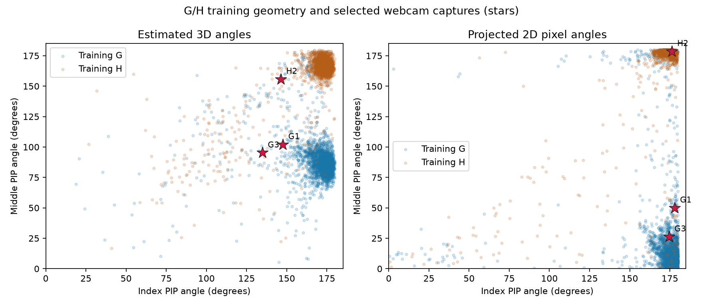

# G-versus-H diagnostic classifiers

Three fixed SVMs use only 15 estimated 3D angles, 14 projected 2D angles, or all 29 together. No Shin distances/directions, synthetic augmentation or webcam training examples are used. The original five filename-block folds are restricted to G/H, with scaling and imputation fitted only on the training partition. This is an easier binary task: its scores are not evidence of improvement on all 26 letters.

## Is G already difficult in the existing dataset?

| Existing 26-class model | Letter | Correct | Recall | Precision | Errors |
|---|---|---:|---:|---:|---|
| Reference | G | 2416/2430 | 99.424% | 98.895% | H: 5, J: 9 |
| Reference | H | 2327/2371 | 98.144% | 98.811% | J: 30, Q: 1, S: 1, G: 9, M: 1, P: 1, W: 1 |
| Joint angles | G | 2416/2430 | 99.424% | 98.935% | H: 4, J: 9, F: 1 |
| Joint angles | H | 2328/2371 | 98.186% | 98.644% | J: 29, S: 1, G: 10, M: 1, P: 1, W: 1 |

G is well recognized on the accepted dataset images. This does not imply reliable webcam recognition: only 2,430/3,000 G and 2,371/3,000 H source images were accepted by the landmark workflow. Filename blocks are not verified independent people, and online/webcam hand views may differ.

## Binary five-fold results

| Representation | Accuracy | Macro-F1 | G recall | H recall |
|---|---:|---:|---:|---:|
| 3D only | 96.563% | 0.96563 | 96.584% | 96.542% |
| 2D only | 95.793% | 0.95791 | 96.502% | 95.065% |
| 2D + 3D | 96.584% | 0.96584 | 96.337% | 96.837% |

## Previously selected G/H webcam errors

| Intended | Saved prediction | 3D only | 2D only | Both |
|---|---|---|---|---|
| G (20261031T152108010733Z_9233886f) | C | H | G | H |
| H (20261031T152116143793Z_11756e66) | C | H | H | H |
| G (20261031T181839806179Z_9ef071cc) | H | H | H | H |

These known, manually selected errors were used to motivate this investigation. They are development diagnostics, not an independent webcam accuracy estimate. A binary model always chooses G or H, even if shown K, X or another letter. It must not be installed as an unrestricted replacement for the main recognizer.



The plot shows just index/middle PIP angles; the models use all listed joint angles. Projected 2D angles are view-dependent, and 3D angles are landmark estimates rather than anatomical ground truth.

## Reproduce

```bash
MPLCONFIGDIR=/tmp/ktai-mpl python -m research.studies.compare_gh_classifier
```

Requires the frozen original inputs and `results/angles_2d_01/pixel_angles.npz` from the preceding 2D-angle experiment. Model bundles are saved separately under `models/gh_diagnostic/`; earlier models remain intact. The fixed protocol and fold checkpoints support reruns without choosing a favorable split or overwriting existing bundles.

## Interpretation and additional diagnostic

The newest G is still H for all three predeclared representations. The earlier G is recovered by the 2D-only model; the earlier H is recovered by all three. Thus the initial binary experiment does not solve the latest G.

In the latest G, the middle-PIP 3D angle (95°) resembles training G (median 87°) rather than H (166°), but other joints give different evidence. Middle-DIP is 161° versus medians 113° for G and 170° for H. The signed thumb-MCP deviation is -1.5°, far from both training medians (G 36°, H 37°). The classifier therefore receives a combination that differs from typical training hands; the middle-PIP plot alone does not describe its entire input. These measurements cannot establish whether the discrepancy comes from pose differences, estimation error, or both.

After inspecting these outcomes, one explicitly **post-hoc** ablation isolated only the middle-PIP 3D and 2D measurements. It recognizes both stored G examples and the stored H example correctly. However, its same-fold dataset accuracy is 94.085%, macro-F1 .94084, below the fuller angle-only classifiers. This demonstrates that the measurements contain a useful G/H signal in these three examples; it does not validate a general recognizer or a reliable correction rule. No settings were tuned after this additional ablation. See [additional diagnostic](../gh_middle_01/report.md).

A new balanced G/H webcam round, including successful and failed attempts and preferably a second signer, is needed before considering a gated second-stage recognizer. The known errors here were reused to develop the hypothesis and cannot serve as independent confirmation.

## Inspect the G training images

- [24 representative positions in the accepted G image list](G_training_examples.png).
- [All 2,430 accepted G filenames and absolute paths](G_training_files.txt).

The images themselves remain in `data/asl_kaggle/images/`; the original filenames are recorded in `data/asl_kaggle/manifest.json`. No second dataset copy was created.
