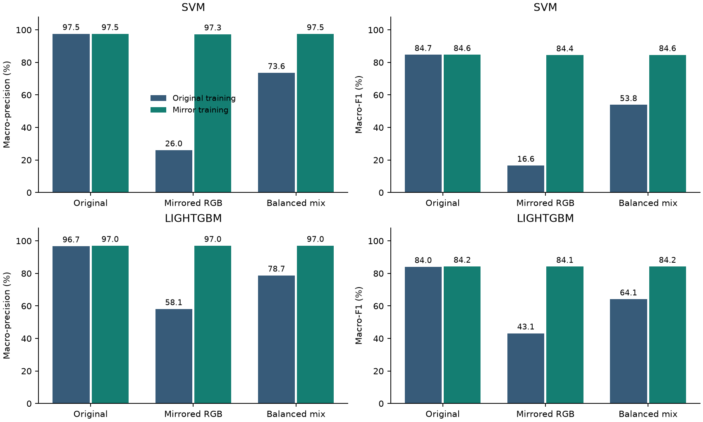

# Horizontal RGB mirroring for hand-side robustness

This is one fixed augmentation experiment, separate from the primary hand-feature study. It asks whether training with original images plus horizontal RGB mirrors improves precision and F1 on held-out mirror presentations without sacrificing original-image performance.

## Original dataset handedness

In the historical cache, 57,424/60,251 accepted images (95.31%) are labelled Right by MediaPipe, and 2,827 (4.69%) Left. The other 17,749 source images lack an accepted single-hand detection. These are detector estimates of the depicted hand, not human-confirmed handedness or signer dominance.

## Frozen protocol

- Process all 78,000 original A-Z images and their horizontal pixel reflections with the same detector, model and 0.5/0.5 thresholds in IMAGE mode. No pixel interpolation, rotation or anatomical landmark-index swapping.
- Redetect both views independently. Use the detector-returned image/world landmarks and handedness, then the unchanged live 835-input encoder. Merely changing a handedness label is not augmentation.
- Use the five existing source filename-block folds. A source and every derivative always share a group and held-out fold. The folds are not verified signer groups.
- Train the baseline on newly accepted original fitting sources. For the candidate, add an accepted mirrored view only for those same sources. Failed mirrors do not remove originals; mirror-only recoveries do not expand the source population.
- Preserve total fitting weight one per source (0.5 + 0.5 when both views are available). Fit angle preprocessing on original fitting rows only; preserve SVM gamma and original balanced class weights. Fixed classifier recipes, no tuning.
- Evaluate the same models on originals, mirrors, and a fixed random mix with one view per source. The seed is 20261106; within each letter/fold, half the sources select a mirror.
- All-attempt scores retain failed detections as no prediction (?). Conditional and paired-both-accepted scores are also exported. Precision is macro-averaged over A-Z; no prediction lowers recall/F1 but does not create a false positive.

The random mix contains **39,000 originals and 39,000 mirrors**. Of its accepted detections, 29,584 are labelled Left and 30,641 Right. Equal reflection frequency does not guarantee exactly equal detected hands.

## Detection coverage

| View | Accepted / attempts | Coverage | Detector Left | Detector Right |
|---|---:|---:|---:|---:|
| original | 60,251/78,000 | 77.24% | 2,827 | 57,424 |
| mirrored_rgb | 60,201/78,000 | 77.18% | 56,405 | 3,796 |

Both views are accepted for 58,941 sources; handedness predictions swap for 54,680 of those pairs.

## Main results: all attempted held-out sources

| Learner | Presentation | Training | Accuracy | Macro-precision | Macro-recall | Macro-F1 |
|---|---|---|---:|---:|---:|---:|
| SVM | Original | Original training | 75.505% | 97.539% | 75.505% | 0.846698 |
| SVM | Original | Mirror training | 75.472% | 97.495% | 75.472% | 0.846404 |
| SVM | Mirrored RGB | Original training | 17.983% | 26.007% | 17.983% | 0.165544 |
| SVM | Mirrored RGB | Mirror training | 75.226% | 97.293% | 75.226% | 0.844011 |
| SVM | Balanced mix | Original training | 46.733% | 73.566% | 46.733% | 0.538491 |
| SVM | Balanced mix | Mirror training | 75.386% | 97.451% | 75.386% | 0.845599 |
| LIGHTGBM | Original | Original training | 74.941% | 96.713% | 74.941% | 0.840063 |
| LIGHTGBM | Original | Mirror training | 75.104% | 96.990% | 75.104% | 0.842061 |
| LIGHTGBM | Mirrored RGB | Original training | 38.178% | 58.106% | 38.178% | 0.431332 |
| LIGHTGBM | Mirrored RGB | Mirror training | 74.985% | 96.996% | 74.985% | 0.841321 |
| LIGHTGBM | Balanced mix | Original training | 56.569% | 78.737% | 56.569% | 0.641039 |
| LIGHTGBM | Balanced mix | Mirror training | 75.051% | 97.012% | 75.051% | 0.841770 |

## Paired changes

- SVM, Original: macro-precision -0.044 percentage points; macro-F1 -0.000295; 180 corrected, 206 lost, net -26.
- SVM, Mirrored RGB: macro-precision +71.286 percentage points; macro-F1 +0.678467; 44,867 corrected, 218 lost, net +44,649.
- SVM, Balanced mix: macro-precision +23.885 percentage points; macro-F1 +0.307108; 22,568 corrected, 219 lost, net +22,349.
- LIGHTGBM, Original: macro-precision +0.277 percentage points; macro-F1 +0.001999; 518 corrected, 391 lost, net +127.
- LIGHTGBM, Mirrored RGB: macro-precision +38.889 percentage points; macro-F1 +0.409990; 28,841 corrected, 132 lost, net +28,709.
- LIGHTGBM, Balanced mix: macro-precision +18.275 percentage points; macro-F1 +0.200731; 14,679 corrected, 263 lost, net +14,416.

## Balanced-mix fold differences

| Learner | Fold | Precision change (pp) | F1 change |
|---|---:|---:|---:|
| SVM | 1 | +23.9772 | +0.260245 |
| SVM | 2 | +21.6473 | +0.281532 |
| SVM | 3 | +22.3266 | +0.340430 |
| SVM | 4 | +20.5372 | +0.319265 |
| SVM | 5 | +23.9650 | +0.345334 |
| LIGHTGBM | 1 | +17.2314 | +0.181342 |
| LIGHTGBM | 2 | +12.6223 | +0.171622 |
| LIGHTGBM | 3 | +15.9519 | +0.202655 |
| LIGHTGBM | 4 | +15.6783 | +0.215759 |
| LIGHTGBM | 5 | +21.0289 | +0.230239 |

These five fold differences are descriptive. Training sets overlap, and filename blocks are not independent signer samples.

The SVM balanced-mix F1 change is +0.307108, while its original-view change is -0.000295. This distinguishes reflection robustness from original-distribution performance. The observed mixed-presentation gain is not a universal improvement or a measured real-left-signer effect.



## Interpretation and limits

These results measure robustness to synthetic horizontal RGB reflection. No real left-handed signer test was collected. The dataset hand labels are estimated, the source folds are not known people, and the same family of development folds has been inspected before. The balanced mix is a controlled presentation distribution, not an estimate of population prevalence. J and Z are static dataset poses; their movement is not evaluated. Precision/F1 gains on mirrors must be read alongside original-image regressions, detection coverage and all-letter results. The earlier 97.748% world-joint score used historical accepted detections; compare the two fresh arms here instead of attributing any redetection differences to augmentation.

Per-letter precision/recall/F1 are in `per_letter.csv`; all fold scores in `metrics.csv`; no-prediction columns are retained in confusion matrices. `handedness_metrics.csv` is a detector-labelled diagnostic, not a ground-truth left/right evaluation.

## Reproduce and try live

```bash
python -m RQ3 mirrors
python -m RQ3 mirrors --action verify
python -m research.live_camera --model models/asl_shin_angles_mirrored.joblib
```

The extraction stage resumes matching chunks; CV reuses fold models only under the saved protocol. Full-data training refuses to overwrite existing live bundles. The previous default live model remains available.
